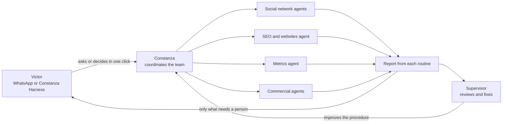
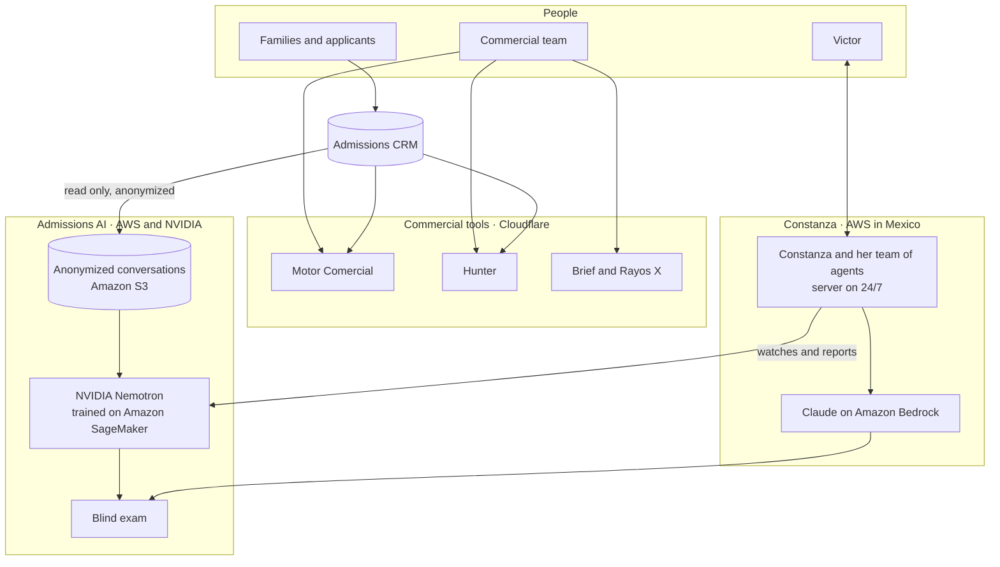

# Victor Gallo

**Experto en procesos comerciales educativos + IA** (educational sales process expert + AI) · sales lead at [SuperLeads](https://superleads.mx) · León, Guanajuato, Mexico

**[Leer en español](README.md)**

I help private schools and universities enroll more students, with data.

I come from finance — BanBajío, Globant, GBM — and I read an admissions funnel the way I read an income statement. I sell during the day. And with a team of AI agents that I run myself, I build the tools I sell with.

SuperLeads' code is proprietary and lives in private repositories. This profile holds what can be shared: what each piece solves, how it is put together, what state it is in and what I decided when designing it. No client names, nobody's data.

## SuperLeads in brief

- **What it is.** The CRM and admissions system for private schools and universities in Mexico and Latin America.
- **Who it serves.** About 100 institutions.
- **The problem.** In admissions, 48 out of 100 families write for the first time outside office hours, and in 52 out of 100 conversations nobody invites them to visit the campus. That is where enrollments are lost. (Our own measurement, explained in [the AWS and NVIDIA case](https://github.com/victorgalloo/superleads-ai-aws-nvidia).)
- **How it has grown.** 100% bootstrapped, with no outside investment. Every tool has to earn its place, which is why everything is measured.
- **My role.** I am the sales lead. I diagnose institutions, close deals and build the system the commercial team works with.

## At a glance

As of November 24, 2026. These figures come from my internal metrics board; an agent refreshes them every 3 days.

| What | Figure | What it counts |
|---|---|---|
| AI agents, each owning one area | 35 | One per social network, SEO, metrics, clients, events and more |
| Active routines | 97 | My team only: scheduled tasks with a written procedure and an expected result. The whole server, with the rest of SuperLeads and internal ones, runs more |
| Times they worked in 3 days | 285 | November 21 to 23; excludes those that run every few minutes |
| My requests on record | 205, with 72% resolved | Everything I ask for stays on the list until it is closed |
| Time to answer me | 2.7 minutes (median) | 23 of 26 messages answered in the period |
| Work to date | About 1,290 saved changes across 540 sessions | August 11 to November 15, 2026 |

What went wrong is counted too: at this cut, 3 of 26 messages went unanswered. None of the 97 routines failed on its last run; at the November 21 cut, 3 had failed, and they have since been fixed.

## What I build

Project pages are written in Spanish; the two marked EN have an English version.

| Project | What it solves | Status | Built with |
|---|---|---|---|
| [Constanza Harness](en/constanza-harness.md) (EN) | I run a team of AI agents like a team of people: each with an area, pending items and a report | In daily use | Own server on AWS, Claude on Amazon Bedrock |
| [Motor Comercial](proyectos/motor-comercial.md) | Every morning each salesperson knows whom to write to, what to say and why | In daily use | Cloudflare Workers, D1, TypeScript |
| [Hunter](proyectos/hunter.md) | Sorts the whole CRM by institution and builds the 30-day reactivation plan | In daily use | Cloudflare Workers, D1 |
| [Brief Agendado](proyectos/brief-agendado.md) | Researches the prospect before the meeting and sends the brief the same day | In use | Cloudflare Workers, calendars |
| [Rayos X de Inscripciones](proyectos/rayos-x.md) | The admissions diagnosis, filled in live with the institution | In use | Next.js on Cloudflare, D1 |
| [Admissions model](proyectos/modelo-de-admisiones.md) | Our own AI that answers families and invites them to visit, without quoting prices | In testing: offline exam, has not talked to real families yet | NVIDIA Nemotron, Amazon SageMaker, S3, Bedrock |
| [Video generator](proyectos/generador-de-video.md) | From a written idea to a video ready to publish | In use | Remotion, React |
| [Publisher](proyectos/publicador.md) | Publishes approved content to each network, exactly once | In use | Cloudflare Workers, D1, R2 |
| [Prospecta](proyectos/prospecta.md) | Matches the portfolio against who is advertising today | Own use | TypeScript, browser |
| [Call analysis](proyectos/analisis-de-llamadas.md) | Which objections repeat across recorded calls | Own use | Python, batches |
| [Commercial inventory](proyectos/inventario-comercial.md) | A plan where every figure was counted at the source | Internal document | Data from each system |
| [Enrollment with CoDi](https://github.com/victorgalloo/inscripcion-codi) | The family pays the enrollment fee from the same WhatsApp conversation | Prototype with fictional data (Hackatón México 2026) | Public code |

## My agents and Constanza Harness

Constanza is the name of SuperLeads' AI. Constanza Harness is the page I run her from: not a dashboard of figures, but a chat with a team.

- **One agent per area, with a face and a name.** One for each social network, one for SEO and websites, one for metrics, one for clients and partners, one for events. Each answers for its own area.
- **One-click pending items.** When something needs me, it arrives with what I need to decide and is resolved with one tap. What I write is answered on the same line.
- **Routines that fix themselves.** A supervisor reviews every afternoon what ran, finds what failed and fixes it. What was learned is saved in that task's procedure.
- **Only what needs a person reaches me.** An access, money, something legal or an authorization.
- **Nothing goes out in my name without my approval.** Anything written to a person starts in rehearsal mode and is approved with one tap.
- **Metrics every 3 days, backup every night.** One agent builds the results cut; another backs up procedures and routines.

How it works, how it is kept safe and what I have learned: [Constanza Harness](en/constanza-harness.md).

## Architecture

Three layers that share data and infrastructure. The full version, service by service, is in [the architecture of the AWS and NVIDIA case](https://github.com/victorgalloo/superleads-ai-aws-nvidia/blob/main/docs/en/architecture.md).

## Programs and partners

| Program | Status | What it has made possible |
|---|---|---|
| AWS Activate | Accepted in October 2026: US$10,000 in credits granted | Constanza running 24/7 in the AWS Mexico region, and the training of the admissions model |
| NVIDIA Inception | Member since October 2026 | The open Nemotron model as the base of the admissions AI; the AWS credits came through this program |
| Claude for Startups (Anthropic) | Accepted in October 2026 | The analysis of the team's recorded calls |
| Anthropic cybersecurity program | Accepted in November 2026 | No result to report yet |
| Mistral for Startups | Application sent on November 16, 2026; waiting | — |
| AWS Community Builders | On the waitlist since November 20, 2026 | — |

I also contribute to the open-source project [Hermes Agent](https://github.com/NousResearch/hermes-agent), which Constanza runs on: 5 open pull requests as of November 24, 2026.

Detail, with what was achieved and what comes next: [Programs and partners](en/programs.md).

## For those evaluating funding, credits or an ambassador program

**Achieved with what was received (October and November 2026)**

- A commercial operation that works with 35 agents and 97 routines (as of November 24, 2026), running all day in the AWS Mexico region.
- Our own admissions AI, trained on NVIDIA Nemotron with anonymized conversations, and a blind exam that tells us which system to trust with a school. Results and caveats: [the AWS and NVIDIA case](https://github.com/victorgalloo/superleads-ai-aws-nvidia).
- Everything documented in public, in Spanish and English, with dated figures and with what failed.

**What comes next**

- Take the admissions AI from the exam to a pilot with one institution.
- Calls: transcribe them, learn from them and answer by voice.
- Grow from about 100 institutions to several times that without growing the team in the same proportion.

The plan and what is being requested are in [Roadmap and credits ask](https://github.com/victorgalloo/superleads-ai-aws-nvidia/blob/main/docs/en/roadmap-and-credits-ask.md).

**Why support this.** It is AI applied to a concrete problem, in Spanish, in an underserved sector, by a company that already serves about 100 institutions and measures what it does. And I tell it as it is: what is in production, what is in testing and what does not exist yet.

## How I decide when building

- **Logic decides; the model writes.** Whom to write to, when and through which channel comes from rules that can be tested. The model only writes the text.
- **No invented data.** If the evidence is not enough, the answer is "unknown". An honest gap is worth more than a nice-looking number.
- **One screen.** What the salesperson needs today fits in one view. The rest gets in the way.
- **The machine proposes, the person decides.** In Motor and Hunter the system writes the message and a person sends it.
- **Secrets live in a vault.** Not in the repo and not in a loose file.
- **Nothing public carries anyone's data.** Before publishing, a checker looks for names, phone numbers, emails and keys. With a single hit, nothing is published.

## Where to find me

[victorgallo.com](https://victorgallo.com) · [LinkedIn](https://www.linkedin.com/in/victorgalloo/) · [X](https://x.com/victorgallomx) · [SuperLeads](https://superleads.mx)
