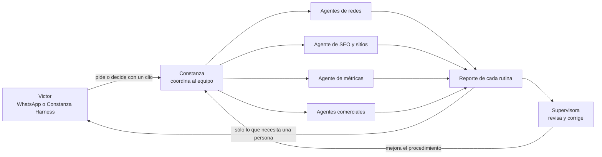

# Victor Gallo

**Experto en procesos comerciales educativos + IA** · líder comercial en [SuperLeads](https://superleads.mx) · León, Guanajuato, México

**[Read in English](README.en.md)**

Ayudo a colegios y universidades privadas a inscribir más alumnos, con datos.

Vengo de finanzas — BanBajío, Globant, GBM — y leo un embudo de admisiones como un estado de resultados. Vendo de día. Y construyo, con un equipo de agentes de IA que dirijo yo mismo, las herramientas con las que vendo.

El código de SuperLeads es de la casa y vive en repositorios privados. Aquí está lo que sí se puede contar: qué resuelve cada pieza, cómo está armada, en qué estado está y qué decidí al diseñarla. Sin nombres de clientes, sin datos de nadie.

## SuperLeads en breve

- **Qué es.** El sistema de CRM y admisiones para colegios y universidades privadas en México y Latinoamérica.
- **A quién sirve.** Cerca de 100 instituciones.
- **Qué problema ataca.** En admisiones, 48 de cada 100 familias escriben por primera vez fuera de horario, y en 52 de cada 100 conversaciones nadie las invita a conocer el plantel. Ahí se pierden las inscripciones. (Medición propia, explicada en [el caso con AWS y NVIDIA](https://github.com/victorgalloo/superleads-ai-aws-nvidia/blob/main/README.es.md).)
- **Cómo ha crecido.** 100% con recursos propios, sin inversión externa. Por eso cada herramienta tiene que ganarse su lugar y por eso se mide todo.
- **Mi papel.** Soy el líder comercial. Diagnostico instituciones, cierro y construyo el sistema con el que trabaja el equipo comercial.

## De un vistazo

Corte del 21 de noviembre de 2026. Estas cifras salen de mi tablero interno de métricas y un agente las pone al día cada 3 días.

| Qué | Cifra | Qué cuenta |
|---|---|---|
| Agentes de IA con un área a su cargo | 25 | Uno por red social, SEO, métricas, clientes, eventos y más |
| Rutinas activas | 62 | Tareas con horario, procedimiento escrito y resultado esperado |
| Veces que trabajaron en 3 días | 166 | Del 18 al 20 de noviembre; no cuenta las que corren cada pocos minutos |
| Pedidos míos registrados | 134, con 81% resueltos | Todo lo que pido queda anotado hasta que se cierra |
| Tiempo en contestarme | 3.3 minutos (mediana) | 14 de 14 mensajes contestados en el periodo |
| Trabajo acumulado | Unos 1,290 cambios guardados en 540 sesiones | Del 11 de agosto al 15 de noviembre de 2026 |

Lo que no salió bien también se cuenta: en este corte, 3 de las 62 rutinas tuvieron una falla en su última vuelta y están en corrección.

## Lo que construyo

| Proyecto | Qué resuelve | Estado | Con qué |
|---|---|---|---|
| [Constanza Harness](proyectos/constanza-harness.md) | Dirijo a un equipo de agentes de IA como a un equipo de personas: cada uno con su área, sus pendientes y su reporte | En uso diario | Servidor propio en AWS, Claude en Amazon Bedrock |
| [Motor Comercial](proyectos/motor-comercial.md) | Cada mañana el comercial sabe a quién escribirle, qué decirle y por qué | En uso diario | Cloudflare Workers, D1, TypeScript |
| [Hunter](proyectos/hunter.md) | Ordena todo el CRM por institución y arma el plan de reactivación de 30 días | En uso diario | Cloudflare Workers, D1 |
| [Brief Agendado](proyectos/brief-agendado.md) | Investiga al prospecto antes de la reunión y manda el brief el mismo día | En uso | Cloudflare Workers, calendarios |
| [Rayos X de Inscripciones](proyectos/rayos-x.md) | El diagnóstico de admisiones que se llena en vivo, con la institución enfrente | En uso | Next.js sobre Cloudflare, D1 |
| [Modelo de admisiones](proyectos/modelo-de-admisiones.md) | Una IA propia que contesta a las familias y las invita a la visita, sin dar precios | En prueba: examen sin conexión, aún no conversa con familias reales | NVIDIA Nemotron, Amazon SageMaker, S3, Bedrock |
| [Generador de video](proyectos/generador-de-video.md) | De una idea escrita a un video listo para publicar | En uso | Remotion, React |
| [Publicador](proyectos/publicador.md) | Publica en cada red lo que ya está aprobado, una sola vez | En uso | Cloudflare Workers, D1, R2 |
| [Prospecta](proyectos/prospecta.md) | Cruza la cartera con quién se está anunciando hoy | Uso propio | TypeScript, navegador |
| [Análisis de llamadas](proyectos/analisis-de-llamadas.md) | Qué objeciones se repiten en las llamadas grabadas | Uso propio | Python, lotes |
| [Inventario comercial](proyectos/inventario-comercial.md) | Un plan donde cada cifra se contó en la fuente | Documento interno | Datos de cada sistema |
| [Inscripción con CoDi](https://github.com/victorgalloo/inscripcion-codi) | La familia paga la inscripción desde la misma conversación de WhatsApp | Prototipo con datos ficticios (Hackatón México 2026) | Código público |

## Mis agentes y Constanza Harness

Constanza es el nombre de la IA de SuperLeads. Constanza Harness es la página desde donde la dirijo: no es un tablero de cifras, es un chat con un equipo.

- **Un agente por área, con cara y nombre.** Uno por cada red social, uno para SEO y sitios, uno para métricas, uno para clientes y aliados, uno para eventos. Cada quien responde por lo suyo.
- **Pendientes de un clic.** Cuando algo necesita de mí, llega con lo necesario para decidir y se resuelve con un toque. Lo que escribo se contesta en el mismo renglón.
- **Rutinas que se corrigen solas.** Una supervisora revisa cada tarde lo que corrió, encuentra lo que falló y lo arregla. Lo aprendido se guarda en el procedimiento de esa tarea.
- **A mí sólo me llega lo que necesita una persona.** Un acceso, dinero, algo legal o una autorización.
- **Nada sale a mi nombre sin mi visto bueno.** Lo que se le escribe a una persona empieza en modo ensayo y se aprueba con un toque.
- **Métricas cada 3 días, respaldo cada noche.** Un agente arma el corte de resultados; otro respalda procedimientos y rutinas.

Cómo funciona, cómo se cuida y qué he aprendido: [Constanza Harness](proyectos/constanza-harness.md).

## Arquitectura

Tres capas que comparten datos e infraestructura. La versión completa, con cada servicio, está en [la arquitectura del caso con AWS y NVIDIA](https://github.com/victorgalloo/superleads-ai-aws-nvidia/blob/main/docs/es/architecture.md).

```mermaid
flowchart TB
  subgraph Personas
    F[Familias y aspirantes]
    E[Equipo comercial]
    V[Victor]
  end
  subgraph Productos[Herramientas comerciales · Cloudflare]
    M[Motor Comercial]
    H[Hunter]
    B[Brief y Rayos X]
  end
  subgraph Operacion[Constanza · AWS en México]
    C[Constanza y su equipo de agentes<br/>servidor encendido 24/7]
    BR[Claude en Amazon Bedrock]
  end
  subgraph Laboratorio[IA de admisiones · AWS y NVIDIA]
    D[(Conversaciones anónimas<br/>Amazon S3)]
    N[NVIDIA Nemotron<br/>entrenado en Amazon SageMaker]
    X[Examen a ciegas]
  end
  CRM[(CRM de admisiones)]
  F --> CRM
  E --> M
  E --> H
  E --> B
  CRM --> M
  CRM --> H
  V <--> C
  C --> BR
  C -->|vigila y reporta| N
  CRM -->|sólo lectura, anonimizado| D
  D --> N
  N --> X
  BR --> X
```

## Programas y aliados

| Programa | Estado | Qué ha permitido |
|---|---|---|
| AWS Activate | Aceptado en octubre de 2026: US$10,000 en créditos otorgados | Constanza encendida 24/7 en la región de AWS en México y el entrenamiento del modelo de admisiones |
| NVIDIA Inception | Miembro desde octubre de 2026 | El modelo abierto Nemotron como base de la IA de admisiones; por esta vía llegaron los créditos de AWS |
| Claude for Startups (Anthropic) | Aceptado en octubre de 2026 | El análisis de las llamadas grabadas del equipo |
| Programa de ciberseguridad de Anthropic | Aceptado en noviembre de 2026 | Todavía sin un resultado que reportar |
| Mistral for Startups | Postulación enviada el 16 de noviembre de 2026; en espera | — |
| AWS Community Builders | En lista de espera desde el 20 de noviembre de 2026 | — |

También aporto al proyecto abierto [Hermes Agent](https://github.com/NousResearch/hermes-agent), sobre el que corre Constanza: 4 propuestas de mejora abiertas al 21 de noviembre de 2026.

Detalle, con lo logrado y lo que sigue: [Programas y aliados](programas.md).

## Para quien evalúa fondeo, créditos o un programa de embajador

**Lo logrado con lo recibido (octubre y noviembre de 2026)**

- Una operación comercial que trabaja con 25 agentes y 62 rutinas, encendida todo el día en la región de AWS en México.
- Una IA de admisiones propia, entrenada sobre NVIDIA Nemotron con conversaciones anónimas, y un examen a ciegas que dice a qué sistema confiarle una escuela. Resultados y advertencias: [el caso con AWS y NVIDIA](https://github.com/victorgalloo/superleads-ai-aws-nvidia/blob/main/README.es.md).
- Todo documentado en público, en español y en inglés, con cifras fechadas y con lo que falló.

**Lo que sigue**

- Llevar la IA de admisiones del examen a un piloto con una institución.
- Las llamadas: transcribirlas, aprender de ellas y contestar por voz.
- Crecer de cerca de 100 instituciones a varias veces eso sin crecer el equipo en la misma proporción.

El plan y lo que se solicita está en [Plan y solicitud de créditos](https://github.com/victorgalloo/superleads-ai-aws-nvidia/blob/main/docs/es/roadmap-and-credits-ask.md).

**Por qué apoyar esto.** Es IA aplicada a un problema concreto, en español, en un sector poco atendido, con una empresa que ya atiende a cerca de 100 instituciones y que mide lo que hace. Y lo cuento como es: lo que está en producción, lo que está en prueba y lo que todavía no existe.

## Cómo decido al construir

- **La lógica decide; el modelo redacta.** A quién escribirle, cuándo y por qué canal sale de reglas que se pueden probar. El modelo sólo escribe el texto.
- **Sin datos inventados.** Si la evidencia no alcanza, la respuesta es «desconocido». Un hueco honesto sirve más que un dato bonito.
- **Una pantalla.** Lo que el comercial necesita hoy cabe en una vista. Lo demás estorba.
- **Propone la máquina, decide la persona.** En el Motor y en Hunter el mensaje lo escribe el sistema y lo manda alguien.
- **Los secretos, en una bóveda.** Ni en el repo ni en un archivo suelto.
- **Lo público no lleva datos de nadie.** Antes de publicar, un verificador revisa nombres, teléfonos, correos y claves. Con un solo hallazgo, no se publica.

## Dónde encontrarme

[victorgallo.com](https://victorgallo.com) · [LinkedIn](https://www.linkedin.com/in/victorgalloo/) · [X](https://x.com/victorgallomx) · [SuperLeads](https://superleads.mx)
