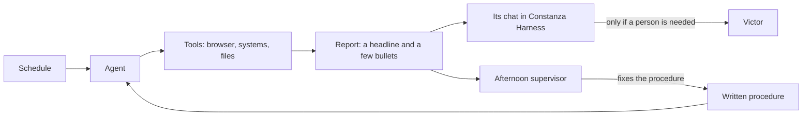

# Constanza Harness

[Leer en español](../proyectos/constanza-harness.md) · [Back to the profile](../README.en.md)

The page I use to run a team of AI agents the way you run a team of people: each with an area, pending items and a report.

## What it solves

Selling leaves little time for everything else: publishing, writing, checking SEO, looking for buying signals, preparing each call, measuring. These are tasks that repeat and that have rules, and rules can be written down.

The problem was not automating one task. It was running sixty without losing track. I tried two dashboards of figures and they did not work for me: I do not read dashboards, I read conversations. That is why Constanza Harness is a chat with a team.

## What it looks like

- **Employees, not routines.** The page shows people on a team: one per social network, one for SEO and websites, one for metrics, one for clients and partners, one for events, one for this GitHub profile. Each has a face, a name and an area.
- **Constanza coordinates.** She sees every routine, builds the summary of the day and tells me what is mine to do.
- **One chat per agent.** I write to whoever owns the topic and get the answer right there. I also talk to her on WhatsApp, by text or voice note. There is a single memory.
- **One-click pending items.** Each item carries one to three facts to decide with and is resolved with one tap. If I resolve it elsewhere, the system notices and removes it.

## How each agent works

- **Every routine has three things in writing:** its schedule, its procedure and the expected result.
- **The report is short.** A headline and three to five bullets, each with its link. No paragraphs.
- **If there is nothing to say, it says nothing.** An agent that found no changes stays quiet.
- **What is learned stays.** When an agent stumbles and solves it, it writes the lesson into its own procedure. The next run already has it.

## How it is kept safe

| Risk | What covers it |
|---|---|
| A routine fails and nobody notices | A supervisor reviews every afternoon what ran and fixes what failed |
| A session that a routine needs gets closed | A watcher sends an alert when it happens |
| A procedure gets lost | Nightly backup to a private repository |
| An agent writes something I would not say | Anything addressed to a person starts in rehearsal mode and I approve it with one tap |
| Private data gets published | A checker looks for names, phone numbers, emails and keys before every publication; with one hit, it does not publish |
| Two agents touch the same thing | A single routine owns each thing |
| I cannot tell whether all this is worth it | A metrics cut every 3 days and a daily log |

Only what truly needs a person reaches me: an access, money, something legal or an authorization.

## How I make a new agent

1. **The request, in my own words.** It is recorded exactly as I said it, so the agent does not reinterpret it.
2. **The procedure.** What it does, under which rules, what it never does and which pitfalls are already known.
3. **The mechanical part goes into a program.** Counting, comparing and checking do not need a model.
4. **The schedule.** It only wakes up when it is due.
5. **A place on the team.** Face, name, area and a chat that works.
6. **A real first run,** checked end to end. What was not exercised is reported as "not tested".

## In numbers

As of November 24, 2026, from the internal metrics board.

| What | Figure |
|---|---|
| Agents, each owning one area | 35 |
| Active routines (my team only) | 97 |
| Times they worked from November 21 to 23 | 285 |
| Routines that failed on their last run | 0 (3 at the November 21 cut, since fixed) |
| Time to answer me (median) | 2.7 minutes |

## How it is built

A server running all day in the AWS Mexico region, with Claude on Amazon Bedrock as the model. Constanza runs on [Hermes Agent](https://github.com/NousResearch/hermes-agent), an open-source project I also contribute to. The page sits behind SuperLeads' sign-in.

SuperLeads' management has its own team of agents on the same page.

## Decisions

- **A chat, not a dashboard.** What I understand at a glance is a conversation.
- **Agents with an area, not one assistant for everything.** Each one builds up craft in its own field.
- **The agent fixes itself; the person decides.** Technical stumbles are not my pending items.
- **What is learned lives in the task's procedure,** not in a general memory.

## Status

In daily use. Procedures and programs live in a private repository.
