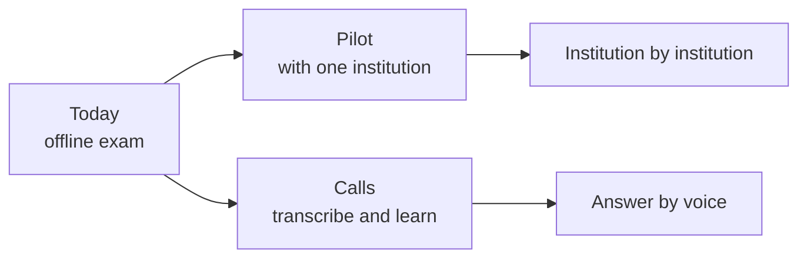

# Programs and partners

[Leer en español](../programas.md) · [Back to the profile](../README.en.md)

SuperLeads has grown 100% bootstrapped. The programs below pay for part of the compute and open doors. This page says what was received, what was done with it and what comes next. As of November 27, 2026.

## Where we stand

| Program | Status | Since |
|---|---|---|
| AWS Activate | Accepted: US$10,000 in credits granted | October 2026 |
| AWS (Kiro credits) | Activated: US$12,000 in credits granted | November 2026 |
| AWS (migration credits) | Granted: US$20,000 in credits, valid until October 2027 | November 2026 |
| Google for Startups Cloud Program | Accepted: US$2,000 in credits granted | October 2026 |
| PostHog for Startups | Accepted: US$50,000 in credits granted | November 2026 |
| NVIDIA Inception | Member | October 2026 |
| Claude for Startups (Anthropic) | Accepted | October 2026 |
| Anthropic cybersecurity program | Accepted | November 2026 |
| Mistral for Startups | Application sent; waiting for an answer | November 16, 2026 |
| AWS Community Builders | On the waitlist | November 20, 2026 |
| OpenAI OpenWorks Partner | Nomination sent; waiting for an answer | November 24, 2026 |

## What was done with what was received

**With AWS**

- Constanza, SuperLeads' AI, running 24/7 in the AWS Mexico region, with Claude on Amazon Bedrock.
- The training of our own admissions AI on Amazon SageMaker, with anonymized conversations stored in Amazon S3.
- A blind exam, graded on Bedrock, that compares our systems against the AI that schools use today.
- Since November 2026, the commercial tools also call Claude through Amazon Bedrock.
- With the Kiro credits, 4 people on the team build with AI assistance (November 2026).

**With Google**

- Since November 2026, several Constanza routines run with Gemini on Vertex AI, with a brake that moves them to Amazon Bedrock before they go past the credits.

**With NVIDIA**

- The open Nemotron model as the base of the admissions AI, trained on NVIDIA GPUs.
- The AWS credits came through the Inception benefits catalog.

**With Anthropic**

- The batch analysis of the commercial team's recorded calls.

The figures behind each point, with method and caveats, are in [the AWS and NVIDIA case](https://github.com/victorgalloo/superleads-ai-aws-nvidia) and its [weekly changelog](https://github.com/victorgalloo/superleads-ai-aws-nvidia/blob/main/docs/en/changelog.md).

## What comes next

- **Pilot.** Take the admissions AI from the exam to real conversations with one institution.
- **Calls.** Admissions are still won over the phone, and today no call is transcribed.
- **Scale.** Grow from about 100 institutions to several times that without growing the team in the same proportion.

The full plan and what is being requested: [Roadmap and credits ask](https://github.com/victorgalloo/superleads-ai-aws-nvidia/blob/main/docs/en/roadmap-and-credits-ask.md).

## What we give back

- **Public documentation,** in Spanish and English, with dated figures and with the attempts that failed.
- **Open-source contributions.** 9 open pull requests as of November 27, 2026: 5 to [Hermes Agent](https://github.com/NousResearch/hermes-agent), 2 to [Amazon Bedrock AgentCore Samples](https://github.com/awslabs/agentcore-samples), 1 to [Strands Agents SDK](https://github.com/strands-agents/harness-sdk) and 1 to [Agent Squad](https://github.com/2FastLabs/agent-squad).
- **A case in Spanish and in Mexico.** Constanza runs in the AWS Mexico region, and the problem we work on belongs to schools in Latin America.
- **What we learn, in writing.** Articles on admissions at [victorgallo.com](https://victorgallo.com).

## What cannot be claimed yet

- The admissions AI has not talked to real families. Everything measured so far is an offline exam.
- The exam's judges are models, not people.
- The balance of credits used is not published here because we cannot read it automatically yet.
