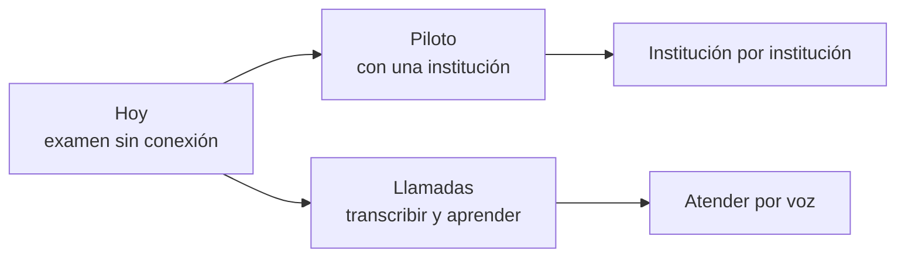

# Programas y aliados

[Read in English](en/programs.md) · [Volver al perfil](README.md)

SuperLeads ha crecido 100% con recursos propios. Los programas de abajo pagan una parte del cómputo y abren puertas. Aquí está qué se recibió, qué se hizo con eso y qué sigue. Corte del 21 de noviembre de 2026.

## Dónde estamos

| Programa | Estado | Desde |
|---|---|---|
| AWS Activate | Aceptado: US$10,000 en créditos otorgados | Octubre de 2026 |
| NVIDIA Inception | Miembro | Octubre de 2026 |
| Claude for Startups (Anthropic) | Aceptado | Octubre de 2026 |
| Programa de ciberseguridad de Anthropic | Aceptado | Noviembre de 2026 |
| Mistral for Startups | Postulación enviada; en espera de respuesta | 16 de noviembre de 2026 |
| AWS Community Builders | En lista de espera | 20 de noviembre de 2026 |

## Qué se hizo con lo recibido

**Con AWS**

- Constanza, la IA de SuperLeads, encendida 24/7 en la región de AWS en México, con Claude en Amazon Bedrock.
- El entrenamiento de una IA de admisiones propia en Amazon SageMaker, con conversaciones anónimas guardadas en Amazon S3.
- Un examen a ciegas, calificado en Bedrock, que compara nuestros sistemas contra la IA que hoy usan las escuelas.
- Desde noviembre de 2026, las herramientas comerciales también llaman a Claude por Amazon Bedrock.

**Con NVIDIA**

- El modelo abierto Nemotron como base de la IA de admisiones, entrenado en GPU de NVIDIA.
- Los créditos de AWS llegaron por el catálogo de beneficios de Inception.

**Con Anthropic**

- El análisis de las llamadas grabadas del equipo comercial, por lotes.

Las cifras de cada punto, con su método y sus advertencias, están en [el caso con AWS y NVIDIA](https://github.com/victorgalloo/superleads-ai-aws-nvidia/blob/main/README.es.md) y en su [bitácora semanal](https://github.com/victorgalloo/superleads-ai-aws-nvidia/blob/main/docs/es/changelog.md).

## Qué sigue

- **Piloto.** Llevar la IA de admisiones del examen a conversaciones reales con una institución.
- **Llamadas.** Las admisiones se siguen ganando por teléfono, y hoy ninguna llamada está transcrita.
- **Escala.** Crecer de cerca de 100 instituciones a varias veces eso sin crecer el equipo en la misma proporción.

El plan completo y lo que se solicita: [Plan y solicitud de créditos](https://github.com/victorgalloo/superleads-ai-aws-nvidia/blob/main/docs/es/roadmap-and-credits-ask.md).

## Lo que devolvemos

- **Documentación pública,** en español y en inglés, con cifras fechadas y con los intentos que fallaron.
- **Aportes a código abierto.** 4 propuestas de mejora abiertas en [Hermes Agent](https://github.com/NousResearch/hermes-agent) al 21 de noviembre de 2026.
- **Un caso en español y en México.** Constanza corre en la región de AWS en México, y el problema que atacamos es de escuelas de Latinoamérica.
- **Lo aprendido, por escrito.** Artículos sobre admisiones en [victorgallo.com](https://victorgallo.com).

## Lo que todavía no se puede afirmar

- La IA de admisiones no ha conversado con familias reales. Todo lo medido es un examen sin conexión.
- Los jueces del examen son modelos, no personas.
- El saldo de créditos usados no se publica aquí porque todavía no lo podemos leer de forma automática.
