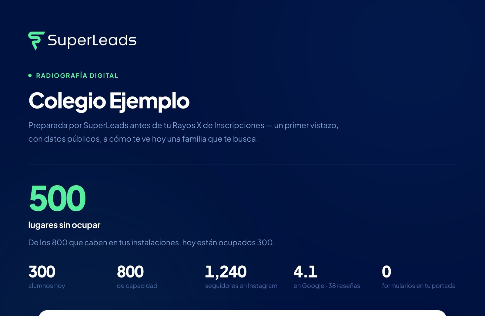
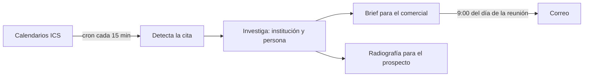

# Brief Agendado

Antes de cada reunión, el comercial recibe un brief del prospecto. No lo pide: llega.

## Qué resuelve

Llegar a una primera llamada sin saber quién está del otro lado cuesta la llamada. Investigar a mano toma media hora que nadie tiene. Aquí la investigación empieza sola en cuanto la cita aparece en el calendario.

## Cómo funciona

- Un cron lee los calendarios conectados cada 15 minutos, por feeds de sólo lectura.
- Una palabra clave en el título de la cita dispara la investigación.
- Se investiga a la institución y a quien la representa.
- El día de la reunión, a las 9 de la mañana, el brief llega por correo a quien es dueño de la cita.
- El prospecto recibe su **Radiografía Digital**: un primer vistazo, con datos públicos, a cómo lo ve hoy una familia que lo busca.

*Plantilla real con un colegio ficticio.*

## Cómo está armado

Worker de Cloudflare en TypeScript, con pruebas en vitest. Cada comercial conecta su propio calendario en autoservicio.

## Decisiones

- El disparador es el título de la cita. Nadie llena un formulario extra.
- La Radiografía usa sólo datos públicos: lo que cualquier familia puede ver.

## Estado

En uso. Lo construyo con el equipo de SuperLeads. Código privado.
