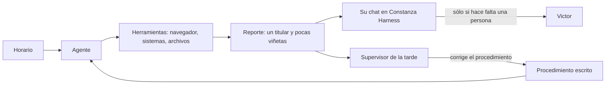

# Constanza Harness

[Read in English](../en/constanza-harness.md) · [Volver al perfil](../README.md)

La página desde donde dirijo a un equipo de agentes de IA como se dirige a un equipo de personas: cada uno con su área, sus pendientes y su reporte.

## Qué resuelve

Vender deja poco tiempo para lo demás: publicar, escribir, revisar el SEO, buscar señales de compra, preparar cada llamada, medir. Son tareas que se repiten y que tienen reglas, y las reglas se pueden escribir.

El problema no era automatizar una tarea. Era dirigir sesenta sin perderme. Probé dos tableros de cifras y no me sirvieron: yo no leo tableros, leo conversaciones. Por eso Constanza Harness es un chat con un equipo.

## Cómo se ve

- **Empleados, no rutinas.** La página muestra personas de un equipo: una por red social, una para SEO y sitios, una para métricas, una para clientes y aliados, una para eventos, una para este perfil de GitHub. Cada una tiene cara, nombre y un área.
- **Constanza coordina.** Ve todas las rutinas, arma el resumen del día y me dice qué me toca.
- **Un chat por agente.** Le escribo a quien lleva el tema y me contesta ahí mismo. También le hablo por WhatsApp, con texto o con notas de voz. La memoria es una sola.
- **Pendientes de un clic.** Cada pendiente trae de uno a tres datos para decidir y se resuelve con un toque. Si lo resuelvo por fuera, el sistema lo detecta y lo quita.

## Cómo trabaja cada agente

- **Cada rutina tiene tres cosas escritas:** su horario, su procedimiento y el resultado que se espera.
- **El reporte es corto.** Un titular y de tres a cinco viñetas, cada una con su liga. Sin párrafos.
- **Si no hay nada que decir, no dice nada.** Un agente que no encontró cambios se queda callado.
- **Lo aprendido se queda.** Cuando un agente tropieza y lo resuelve, anota la lección en su propio procedimiento. La siguiente vuelta ya la trae.

## Cómo se cuida

| Riesgo | Qué lo cubre |
|---|---|
| Una rutina falla y nadie se entera | Un supervisor revisa cada tarde lo que corrió y corrige lo que falló |
| Se cierra una sesión que una rutina necesita | Un vigía avisa en cuanto pasa |
| Se pierde un procedimiento | Respaldo cada noche en un repositorio privado |
| Un agente escribe algo que yo no diría | Lo que va a una persona empieza en modo ensayo y lo apruebo con un toque |
| Se publica un dato privado | Un verificador revisa nombres, teléfonos, correos y claves antes de cada publicación; con un hallazgo, no publica |
| Dos agentes tocan lo mismo | Una sola rutina es dueña de cada cosa |
| No sé si todo esto sirve | Un corte de métricas cada 3 días y una bitácora diaria |

A mí sólo me llega lo que de verdad necesita una persona: un acceso, dinero, algo legal o una autorización.

## Cómo hago un agente nuevo

1. **El pedido, con mis palabras.** Queda anotado tal cual lo dije, para que el agente no lo reinterprete.
2. **El procedimiento.** Qué hace, con qué reglas, qué nunca hace y qué trampas ya se conocen.
3. **Lo mecánico, en un programa.** Contar, comparar y verificar no necesita un modelo.
4. **El horario.** Sólo despierta cuando toca.
5. **Un lugar en el equipo.** Cara, nombre, área y un chat que funciona.
6. **Una primera vuelta de verdad,** revisada de punta a punta. Lo que no se probó se reporta como «no probado».

## En números

Corte del 21 de noviembre de 2026, del tablero interno de métricas.

| Qué | Cifra |
|---|---|
| Agentes con un área a su cargo | 25 |
| Rutinas activas | 62 |
| Veces que trabajaron del 18 al 20 de noviembre | 166 |
| Rutinas con una falla en su última vuelta | 3 |
| Tiempo en contestarme (mediana) | 3.3 minutos |

## Cómo está armado

Un servidor encendido todo el día en la región de AWS en México, con Claude en Amazon Bedrock como modelo. Constanza corre sobre [Hermes Agent](https://github.com/NousResearch/hermes-agent), un proyecto abierto al que también aporto mejoras. La página vive detrás del inicio de sesión de SuperLeads.

La dirección de SuperLeads tiene su propio equipo de agentes en la misma página.

## Decisiones

- **Un chat, no un tablero.** Lo que entiendo de un vistazo es una conversación.
- **Agentes con área, no un solo asistente para todo.** Así cada uno acumula oficio en lo suyo.
- **El agente se arregla solo; a la persona le toca decidir.** Los tropiezos técnicos no son mi pendiente.
- **Lo aprendido vive en el procedimiento de la tarea,** no en una memoria general.

## Estado

En uso diario. Los procedimientos y los programas viven en un repositorio privado.
