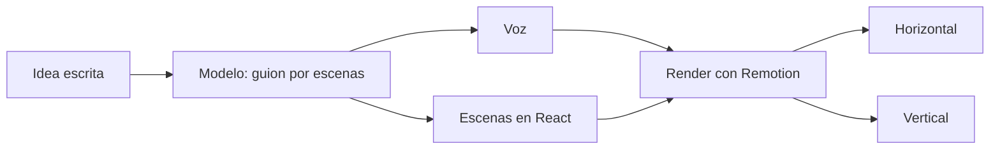

# Generador de video

Escribes la idea. La IA arma la historia. El video sale listo para publicar.

## Qué resuelve

Antes, cada video pasaba por un editor: pedirlo, esperar, revisar, volver a esperar. Y cada variante —otro formato, otra cifra, otro cierre— era empezar de nuevo. Ahora una idea se vuelve video el mismo día, y cada versión es un clic.

## Cómo funciona

- **Escenas listas.** Trece escenas con el diseño y la animación de la marca. Se les cambia el texto y la cifra; lo demás ya está hecho.
- **Dos formatos.** Horizontal para YouTube y presentaciones; vertical para Reels, TikTok y estados de WhatsApp.
- **El guion va amarrado a la música.** Los cortes caen en los golpes de la pista, y la cifra aparece cuando la música se calla.
- **Voz generada.** La locución sale del guion.
- **Propone de qué hablar.** Toma los temas que la gente ya busca y casi nadie responde en video.

## Cómo está armado

Remotion sobre React y TypeScript. Cada escena es un componente; un video es un guion en JSON que dice qué escenas van, con qué texto y en qué cuadro.

## Decisiones

- Las reglas de marca viven en el código. Nadie tiene que acordarse de ellas.
- Los videos con datos de un prospecto real nunca entran al repo.

## Estado

En uso. Lo construyo con el equipo de SuperLeads. Código privado.
