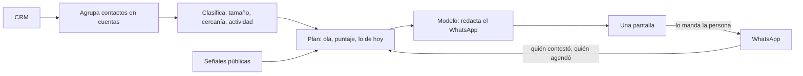

# Hunter

Toma toda la base del CRM, la ordena por institución y dice a cuáles vale la pena volver este mes.

## Qué resuelve

Un CRM de años guarda miles de contactos y ninguna prioridad. Hunter los agrupa en cuentas —una fila por colegio o universidad—, llena cada dimensión con datos y le asigna una acción. Lo que no se puede resolver con evidencia se queda marcado como desconocido, no adivinado.

## Cómo funciona

- **Clasificación.** Tamaño de la institución, qué tan cerca estuvo de cerrar, qué tan reciente fue el último contacto real y con quién se habló. Los envíos masivos no cuentan como actividad.
- **Sólo cuentas frías.** Lo que está activo, es cliente o está en negociación no se toca.
- **El plan de 30 días.** Una sola pantalla: cuántas cuentas, cuántas tocadas, cuántas contestaron y cuántas agendaron. Abajo, los WhatsApp de hoy con su texto listo.
- **Olas.** Primero quien ya tuvo un diagnóstico; luego quien ya platicó por WhatsApp; después WhatsApp en frío; al final, correo.
- **Señales.** Universidades con un hecho público reciente —dirección de admisiones nueva, programa nuevo, vacantes de asesores— suben al principio de la lista.

## Cómo está armado

Worker de Cloudflare con D1 y un cron que rearma el plan cada hora. La decisión (ola, cadencia, acción) es lógica determinista con pruebas; el modelo escribe el mensaje y resuelve identidades dudosas, nada más.

## Decisiones

- Agrupar por nombre no basta: dos colegios distintos se llaman igual. La llave es el nombre dentro del mismo estado, más el dominio propio del correo.
- Máximo tres mensajes por cuenta, espaciados. Después, silencio.
- Las tablas derivadas se reconstruyen sin vaciarlas primero, para que la pantalla nunca lea una tabla a medias.

## Estado

En uso diario. Código privado.
