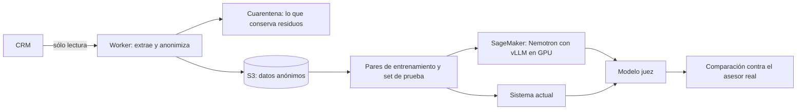

# Un modelo propio de admisiones (NVIDIA · AWS)

Enseñarle a un modelo abierto a contestar como contesta un asesor que sí inscribe. Y medir, antes de gastar, si de verdad mejora.

## Qué resuelve

Hoy los mensajes los redacta un modelo general con instrucciones. Funciona, pero no aprendió de ninguna conversación real de admisiones. La pregunta es concreta: ¿un modelo abierto, ajustado con conversaciones que terminaron en inscripción, contesta mejor? Antes de opinar, ver los números.

## Cómo funciona

1. **Extracción.** Las conversaciones de admisiones salen del CRM por API de sólo lectura.
2. **Anonimizado en el origen.** Nada sale con nombre, teléfono, correo, dirección ni identificador real. Se anonimiza antes de que el dato deje el Worker que lo lee.
3. **Pares de entrenamiento.** El historial de la conversación y, como respuesta, el siguiente mensaje de un asesor humano. Los bots y las plantillas repetidas se quedan fuera.
4. **Set de prueba.** Una parte de las cuentas nunca entra al entrenamiento. Con ellas se mide.
5. **Evaluación.** Sobre ese set se compara el sistema actual, el modelo abierto sin ajustar y, después, el ajustado. Un modelo juez califica cada respuesta contra la que dio el asesor que sí cerró.

## El anonimizado

- Nombres conocidos —del contacto, del asesor, de la institución— se reemplazan por etiquetas.
- Patrones: correo, teléfono, liga, CURP, RFC, código postal y dirección.
- Contexto: lo que sigue a «me llamo», «mi hijo», «mamá de».
- Diccionario de nombres y apellidos comunes en México.
- Cualquier palabra con mayúscula que no esté en el vocabulario común del español se trata como nombre.
- Los identificadores son seudónimos con sal secreta; el nombre real de la cuenta no viaja en los datos.
- Doble control: lo que conserve algún residuo va a cuarentena y no se sube.
- Adjuntos y grabaciones se descartan.

Se anonimiza de más a propósito. Perder el nombre de una escuela cuesta poco; dejar pasar el de una familia, no.

## Cómo está armado

Worker de Cloudflare para extraer y anonimizar. En AWS: S3 para los datos, SageMaker para correr NVIDIA Nemotron dentro de un contenedor de vLLM, en GPU bajo demanda o spot. Python para armar los pares y evaluar.

## Decisiones

- **Medir antes de entrenar.** Si el modelo sin ajustar ya empata, entrenar no se justifica.
- **La prueba se separa por cuenta, no por mensaje.** Si una misma escuela aparece en el entrenamiento y en la prueba, el resultado sale inflado.
- **El asesor de referencia es humano.** Las respuestas automáticas no enseñan a vender.
- **Servir un modelo abierto cuesta una GPU por hora.** Ese costo entra en la decisión, no después.

## Estado

En curso. Datos extraídos y anonimizados, set de prueba armado y evaluación del modelo base en proceso. Todavía no hay un resultado que presumir. Código privado.
