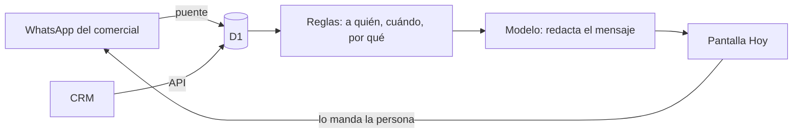

# Motor Comercial

Cada mañana, cada comercial abre el motor y sabe a quién escribirle, qué decirle y por qué. Manda el mensaje con un tap. El CRM se llena solo.

## Qué resuelve

Un pipeline se ve sano y no lo está: la oportunidad que lleva días sin moverse no avisa. El motor le pone siguiente paso a cada una y saca sola la que se quedó quieta. Nadie se pierde por desorden.

## Cómo funciona

- **Hoy.** Una tarjeta por jugada: el prospecto, por qué toca hoy y el mensaje ya escrito. Se edita, se copia y se manda por WhatsApp.
- **El WhatsApp alimenta al motor.** Las conversaciones del comercial suben solas; el motor sabe quién contestó y qué se habló.
- **Sincronizar.** Un botón pone al día dueños, etapas, citas y cierres contra el CRM.
- **Lecciones.** Cada corrección a un mensaje se guarda como regla y aplica a los siguientes.

## Cómo está armado

Worker de Cloudflare con D1, en TypeScript, con pruebas en vitest. Las reglas viven en módulos puros, separados de la base, para poder probarlas sin red.

## Decisiones

- El motor no manda nada por su cuenta. Escribe; la persona envía.
- El orden del día sale del puntaje y de los días sin tocar, no de una lista que alguien acomoda a mano.
- Cada marca tiene su manual de estilo; el motor lo lee antes de escribir.

## Estado

En uso diario. Lo construyo con el equipo de SuperLeads. Código privado.
