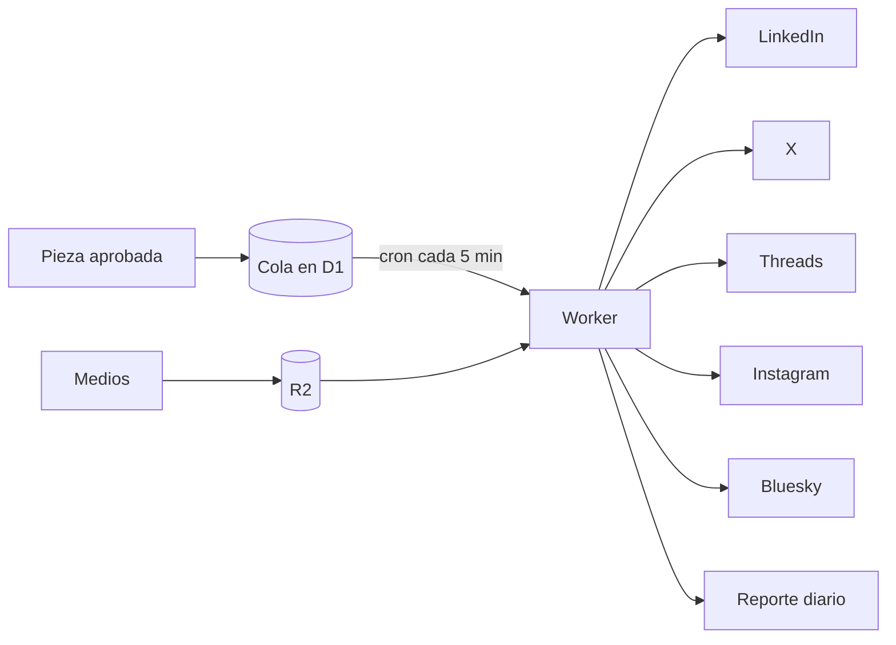

# Publicador

Publica en cada red lo que ya está aprobado. Una sola vez.

## Qué resuelve

Publicar a mano en cinco redes es repetir el mismo trabajo cinco veces, y ahí nacen los errores: el post duplicado, el video que no subió, la llave que venció sin avisar. El Publicador toma la pieza aprobada y se encarga del resto.

## Cómo funciona

- **Cola.** Cada pieza entra con su red, su texto o hilo, sus medios y su fecha.
- **Cron cada 5 minutos.** Publica lo que ya venció.
- **Idempotencia.** Cada pieza lleva un identificador único: nada sale dos veces, aunque el cron se repita.
- **Reporte diario.** Qué salió, qué falló y qué llave está por vencer.
- **Interruptores.** Cada red se enciende por separado; las que están en revisión publican en modo borrador.

## Cómo está armado

Worker de Cloudflare en TypeScript, con D1 para la cola y R2 para los medios. Las llaves salen sólo de la bóveda de secretos; ninguna vive en el repo.

## Decisiones

- Sólo publica lo aprobado. Escribir es otro paso, y lo revisa una persona.
- La superficie pública es mínima: la liga de los medios y un chequeo de salud.

## Estado

En uso. Código privado.
