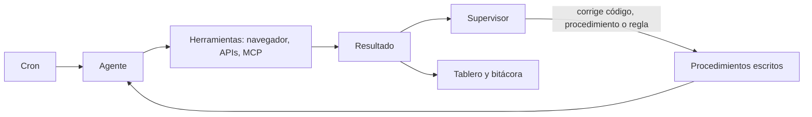

# Rutinas con agentes

Un agente corre mi operación diaria en un servidor. Y cuando una rutina falla, él mismo la corrige.

## Qué resuelve

Vender deja poco tiempo para lo demás: publicar, escribir, revisar el SEO, buscar señales de compra, armar el resumen del día. Son tareas que se repiten y que tienen reglas. Las reglas se pueden escribir.

## Cómo funciona

- **Rutinas programadas.** Cada una tiene su horario, su procedimiento escrito y su resultado esperado: contenido para mis redes, artículos, SEO, señales de universidades, el resumen del día.
- **Un supervisor.** Revisa a las demás, encuentra lo que falló y lo corrige en la misma corrida: código, procedimiento o regla.
- **Un tablero en vivo.** Qué corrió, qué salió y qué está pendiente.
- **Una bitácora.** Lo que se hizo cada día queda escrito.
- **Instrucciones desde donde esté.** Le escribo por WhatsApp o desde la computadora; la memoria es una sola.

## Cómo está armado

Un servidor propio, cron, y herramientas conectadas por MCP. Las conversaciones de WhatsApp se consultan por un puente de sólo lectura.

## Decisiones

- A mí sólo me llega lo que de verdad necesita una persona: un inicio de sesión, dinero o algo legal.
- Lo que el agente aprende haciendo una tarea se guarda en el procedimiento de esa tarea, no en una memoria general.

## Estado

En uso diario. Procedimientos y scripts en un repo privado.
